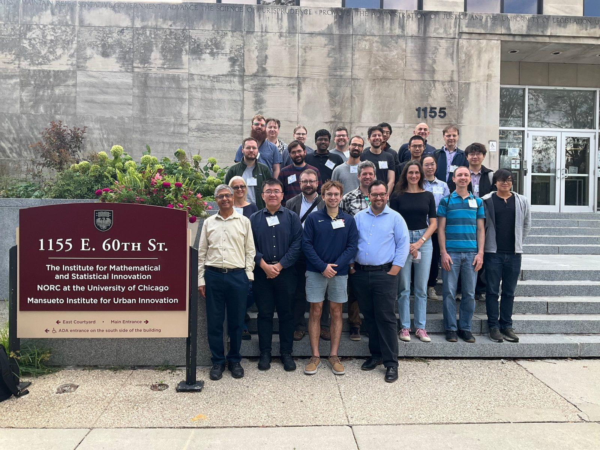

I will co-organize (with [Anil Hirani](https://hirani.web.illinois.edu/) and [Kaushik Kalyanaraman](https://www.iiitd.ac.in/kaushik)) and participate in the [IMSI](https://www.imsi.institute/) Workshop ''[Discrete Exterior Calculus: Differential Geometry and Applications](https://www.imsi.institute/activities/discrete-exterior-calculus/)'', Chicago, USA.

 

 

<small>Group photo from the workshop hosted by the <a href="https://www.imsi.institute/activities/discrete-exterior-calculus/">Institute for Mathematical and Statistical Innovation (IMSI)</a>.</small>
