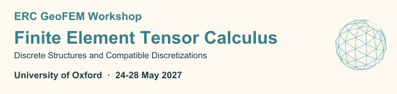

With [Boris Andrews](https://borisandrews.github.io/), [Jia Jia Qian](https://www.maths.ox.ac.uk/people/jiajia.qian), and [Puchun Zhou](https://phzpc98.github.io), I am co-organising the ERC [GeoFEM](/geofem/) workshop "Finite Element Tensor Calculus: Discrete Structures and Compatible Discretizations" at Oxford on May 24-28, 2027. [poster](/assets/pdf/geofem-workshop-2027.pdf) (upcoming)

 

 
