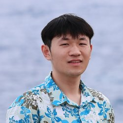
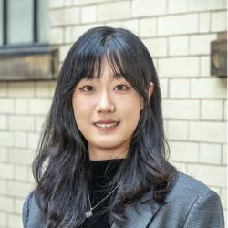
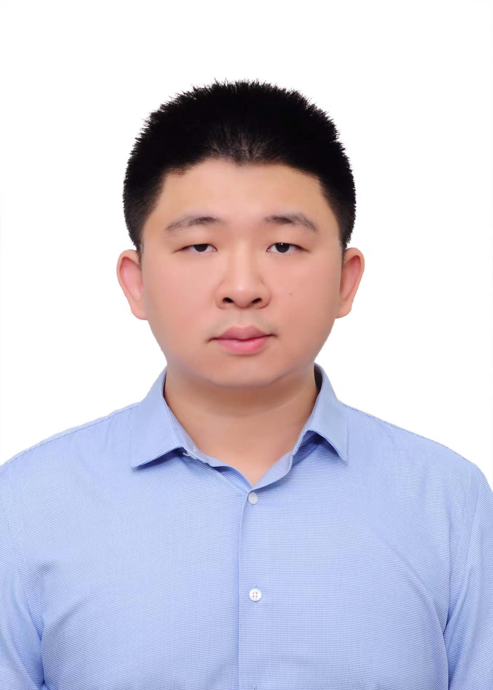
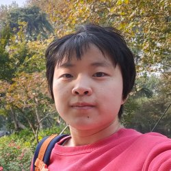
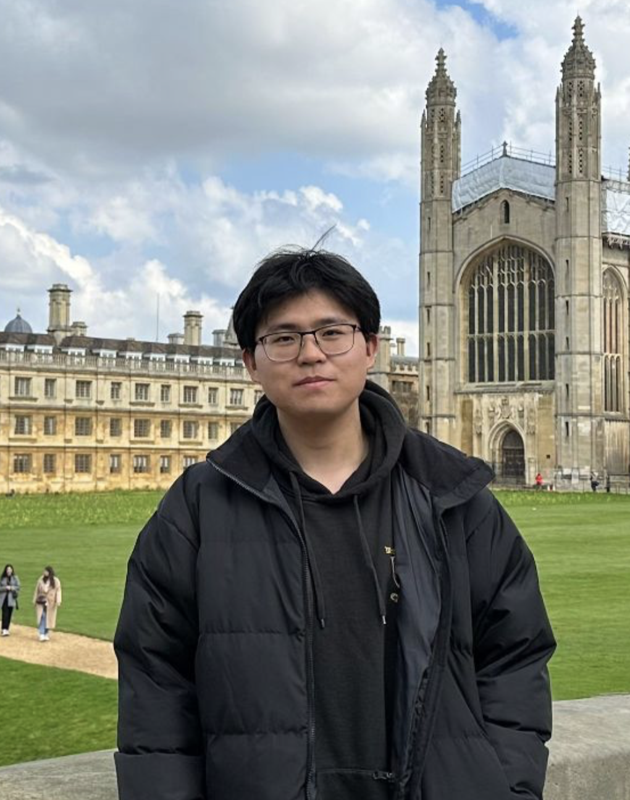
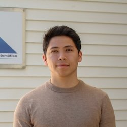
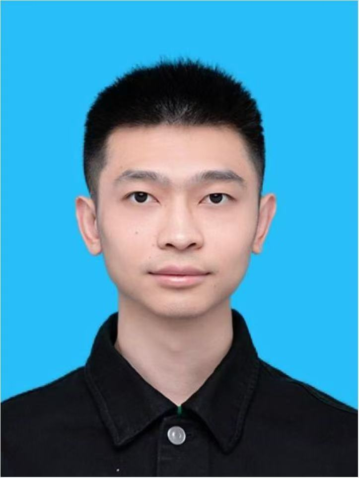
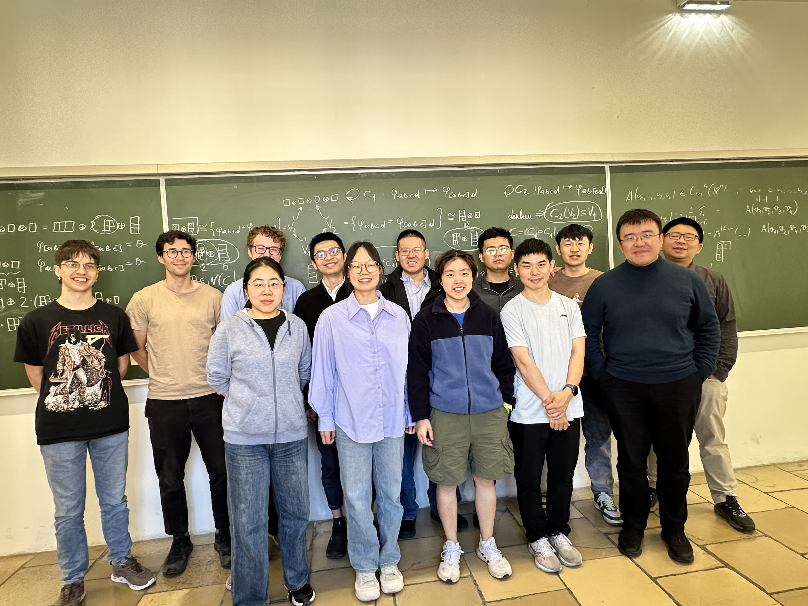

 

## Current Members

 

<strong>Externally funded fellows &amp; postdocs</strong>

  
  

    <strong><a href="https://jindong24.github.io/">Jindong Wang</a> (Newton International Fellow)</strong> 
    <em>2026–</em>
  

  
  

    <strong><a href="https://sites.google.com/view/yuyanghuang/home">Yuyang Huang</a> (1851 Research Fellow)</strong> 
    <em>2026–</em>
  

 

<strong>Postdocs</strong>

  
  

    <strong><a href="https://borisandrews.github.io">Boris Andrews</a></strong> 
    <em>2025–</em>
  

  
  

    <strong><a href="https://scholar.google.com/citations?user=Z4bLK94AAAAJ&hl=en">Yizhou Liang</a></strong> 
    <em>2025–</em>
  

  
  

    <strong><a href="https://www.maths.ox.ac.uk/people/jiajia.qian">Jia Jia Qian</a></strong> 
    <em>2025–</em>
  

  
  

    <strong><a href="https://phzpc98.github.io">Puchun Zhou</a></strong> 
    <em>2025–</em>
  

 

<strong>PhD Students</strong>

  
  

    <strong><a href="https://sites.google.com/view/mingdonghe/home/">Mingdong He</a></strong> 
    <em>2023–</em> (joint supervision with Patrick Farrell)
  

  
  

    <strong><a href="https://markalvares.co.uk">Mark Alvares Peres</a></strong> 
    <em>2025–</em>
  

  
  

    <strong><a href="https://olavtyssvang.github.io/">Karl Olav Tyssvang</a></strong> 
    <em>2025–</em> (joint supervision with Snorre Christiansen)
  

  
  

    <strong><a href="https://zzzyc001.github.io">Yuechen Zhu</a></strong> 
    <em>2025–</em>
  

  
  

    <strong><a href="https://benjamin-venegas.github.io/">Benjamín Venegas</a></strong> 
    <em>2026–</em>
  

  

  

    <strong>Yue Wu</strong> 
    <em>2026–</em> (joint supervision with Patrick Farrell)
  

  

  

    <strong>José Ramón Contreras Barberá</strong> 
    <em>2026–</em>
  

 

## Alumni

 

<strong>Postdocs</strong>

  
  

    <strong><a href="https://ganghui-zhang.github.io/">Ganghui Zhang</a></strong> 
    <em>2025–2026</em> 
    Current Position: Postdoc, Hong Kong Polytechnic University
  

  

  

    <strong><a href="https://marienhanot.fr">Marien Hanot</a></strong> 
    <em>2024</em> 
    Current Position: Maître de Conférences, Université de Lille
  

 

  

 

 

  
  

    Group picture of students, postdocs, and visitors during the ESI program
    <a href="https://www.esi.ac.at/events/e585/">“Differential Complexes: Theory, Discretization, and Applications”</a>,
    Vienna, May 2026.
  

